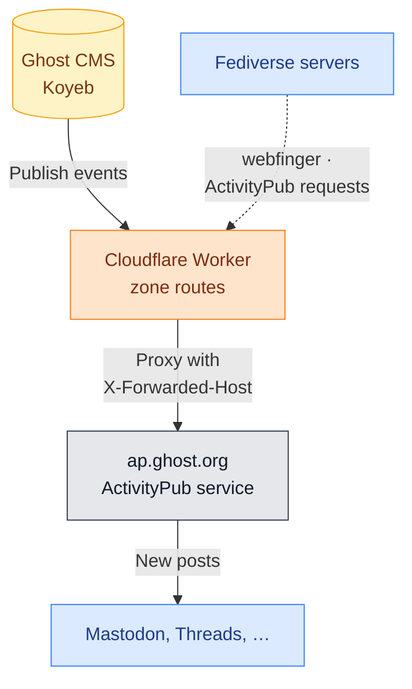
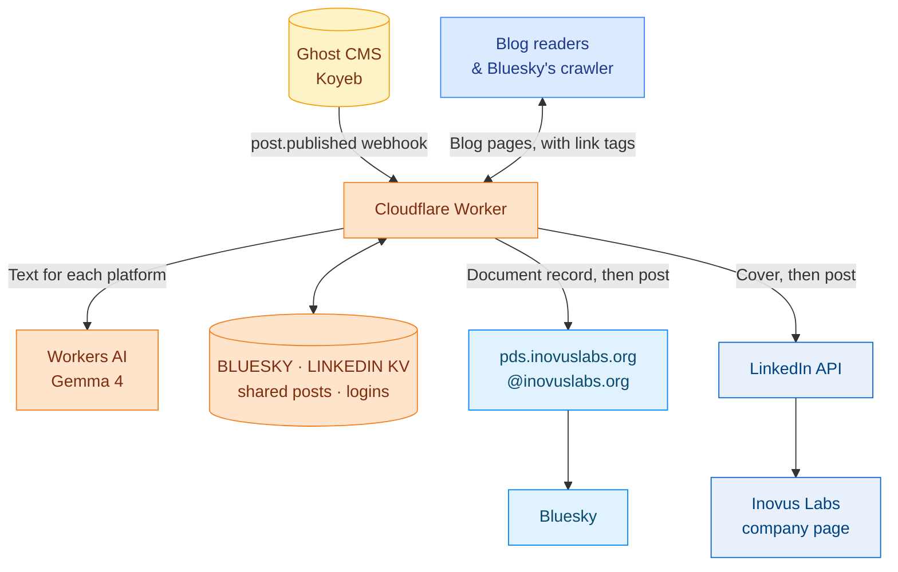
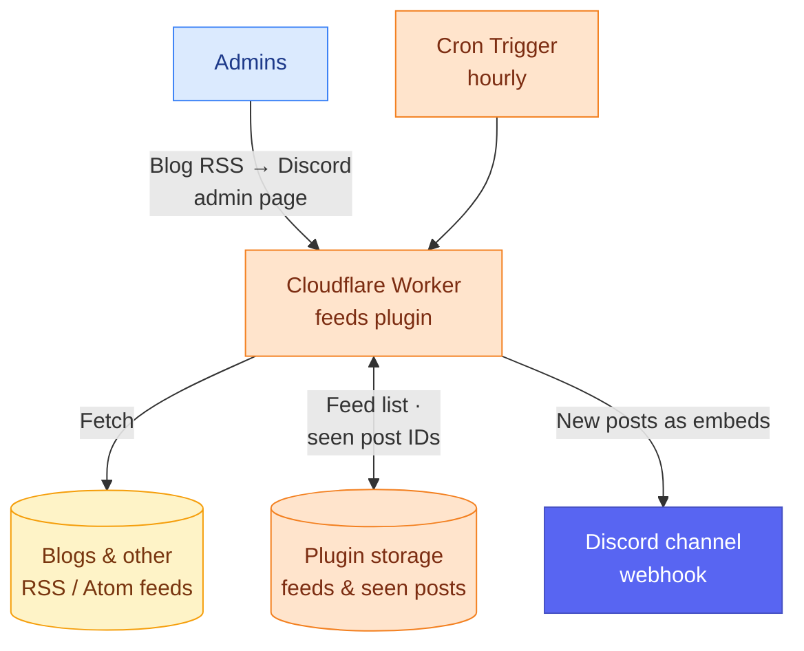

# Kiosk Worker — EmDash CMS, Ghost social web, Bluesky, LinkedIn + Blog RSS → Discord

This directory is an [EmDash](https://emdashcms.com/) site (Astro, server-rendered) deployed to a Cloudflare Worker at **[kiosk-cms.inovuslabs.org](https://kiosk-cms.inovuslabs.org)**, backed by **D1** (`kiosk-db`), a private **R2** bucket (`kiosk-media`), and a **KV** namespace (`kiosk-sessions`) for admin sessions, all in the Inovus Labs IEDC Cloudflare account and pinned by ID in [`wrangler.jsonc`](wrangler.jsonc). It's part of the [kiosk display](../README.md) and serves seven purposes:

1. **EmDash admin** at `/_emdash/admin` — lab members sign in with a passkey and manage slides in two collections under the **Slides** folder: **Image slides** (a poster) and **Text slides** (headline, body, theme), so each form only shows its own fields. Drafts, revisions, scheduled publishing, and the media library are built in. Leave **Expires at** empty to keep a slide up indefinitely; a lower **Pinned order** shows first (empty = newest first); an empty **Theme** renders as Midnight.
2. **Slide feed** at `/api/slides.json` — the live slides, already filtered and ordered, read by the GitHub Actions build.
3. **Ghost webhook** at `https://kiosk-cms.inovuslabs.org/api/webhook/ghost?token=…` — receives Ghost custom-integration webhooks, fires `repository_dispatch` at this repo, and shares newly published posts on Bluesky and LinkedIn.
4. **Kiosk plugin** ([`src/plugins/kiosk.ts`](src/plugins/kiosk.ts)) — fires `cms-publish` on slide publish, unpublish, and trash, and unpublishes slides whose `expires_at` has passed. A one-minute Cron Trigger drives both EmDash's scheduled publishing and the expiry sweep, so scheduled and expiring slides reach the kiosk within a minute plus build time.
5. **Ghost social web proxy** ([`src/lib/activitypub.ts`](src/lib/activitypub.ts)) — Cloudflare routes send the blog's ActivityPub paths to Ghost's hosted ActivityPub service. See [Ghost social web](#ghost-social-web).
6. **Blog RSS → Discord** ([`src/plugins/feeds/`](src/plugins/feeds/)) — posts new posts from public blogs we follow by RSS/Atom to a Discord channel. See [Blog RSS → Discord](#blog-rss--discord).
7. **Sharing new posts** ([`src/lib/share/`](src/lib/share/)) — posts each new blog post to Bluesky as [@inovuslabs.org](https://bsky.app/profile/inovuslabs.org) and to the Inovus Labs LinkedIn page, and makes the blog a Standard.site publication. See [Sharing new posts](#sharing-new-posts).

The content model lives in [`seed/seed.json`](seed/seed.json) and is applied on first boot; there are no migration files to maintain. To change it on a live site, see [Evolving a deployed site](https://docs.emdashcms.com/deployment/schema-evolution/).

**Local development** (from this directory):

```bash
bun install
bunx emdash secrets generate --write .env   # once; also add WEBHOOK_SECRET, GH_TOKEN and
                                             # EMDASH_SITE_URL=http://localhost:4321 to .env
bun run dev                                  # admin at http://localhost:4321/_emdash/admin
```

> Publishing a slide locally fires a real `repository_dispatch` if `.env` holds a valid `GH_TOKEN`. Use a dummy token unless you want a real rebuild. Likewise, keep `BLUESKY_APP_PASSWORD` empty in `.env`, or a local Ghost webhook posts to Bluesky.

**Deploy** is automated via **Cloudflare Workers Builds** — pushing to `master` triggers a build that ships the worker. EmDash applies its database migrations and the seed on the first request after a deploy. Open `/_emdash/admin` afterwards to run the setup wizard and register the first admin passkey. Invite other lab members from **Users → Invite** (copy the invite link — no email provider is configured). Configured at the worker level in the Cloudflare dashboard:

| Field | Value |
|---|---|
| Root directory | `/worker` |
| Build command | `bun run build` |
| Deploy command | `bunx wrangler deploy` |

**Worker runtime secrets** (set in Cloudflare dashboard → kiosk-worker → Settings → Variables and Secrets, or `bunx wrangler secret put <NAME>`):

| Name | Description |
|---|---|
| `EMDASH_ENCRYPTION_KEY` | Generate with `bunx emdash secrets generate`; encrypts plugin secrets. Back it up. |
| `WEBHOOK_SECRET` | Random string; same value goes into the Ghost webhook URL as `?token=` |
| `GH_TOKEN` | GitHub fine-grained PAT scoped to this repo with `Contents: write` |
| `BLUESKY_APP_PASSWORD` | App password `blog-autopost` for @inovuslabs.org, made with `pnpm pds app-password create` in the [PDS repo](https://github.com/inovus-labs/pds.inovuslabs.org) |
| `LINKEDIN_CLIENT_SECRET` | Client secret of the LinkedIn app |

## Ghost social web

The blog ([blog.inovuslabs.org](https://blog.inovuslabs.org)) runs as a single Ghost container on Koyeb. Ghost 6's social web (Network) needs a reverse proxy that sends its ActivityPub paths to a separate service — Ghost's own Docker setup does this with Caddy — so the worker takes that role through zone routes in [`wrangler.jsonc`](wrangler.jsonc):

| Route | Handling |
|---|---|
| `blog.inovuslabs.org/.ghost/activitypub/*` | Proxied to `ACTIVITYPUB_TARGET` (`https://ap.ghost.org`) with `X-Forwarded-Host`, which is how the service identifies the site |
| `blog.inovuslabs.org/.well-known/webfinger*` | Same |
| `blog.inovuslabs.org/.well-known/nodeinfo*` | Same |
| `inovuslabs.org/.well-known/webfinger*` | `302` to the blog's webfinger, required by Ghost's custom handle domain (`SOCIAL_WEB_DOMAIN`) |
| `blog.inovuslabs.org/*` | Everything else on the blog, passed through to Ghost with Standard.site `<link>` tags added. See [Bluesky](#bluesky) |

Trailing slashes are stripped before proxying: browsers that opened Network before the proxy existed hold Ghost's year-long `301` that adds one, and the service redirects it away again.



| Network | Account |
|---|---|
| Fediverse (Mastodon, Threads, …) | `@blog@inovuslabs.org` |
| Bluesky | [`@inovuslabs.org`](https://bsky.app/profile/inovuslabs.org), posted by the worker. See [Bluesky](#bluesky) |
| LinkedIn | The [Inovus Labs](https://www.linkedin.com/company/inovuslabs) page, posted by the worker. See [LinkedIn](#linkedin) |

New posts reach them automatically.

## Sharing new posts

When Ghost first publishes a public post, the webhook answers Ghost and then, in the background, shares it on each platform in [`src/lib/share/`](src/lib/share/): [Bluesky](#bluesky) and [LinkedIn](#linkedin). Each platform builds its own post, with its own AI-written text, and publishes it ([`platform.ts`](src/lib/share/platform.ts)); [`index.ts`](src/lib/share/index.ts) runs them independently, so one failing doesn't hold up the other. For a platform with id `name`:

- its KV namespace, bound as `NAME`, keeps `post:<Ghost id>` → the shared post's address, plus the platform's own login. Each Ghost post is shared once: republishing doesn't post again, and unpublishing and edits don't change the shared post.
- `NAME_DRY_RUN` set to `"true"` logs the post it would make instead of posting.

The text comes from Gemma 4 on Workers AI ([`ai.ts`](src/lib/share/ai.ts)), with a prompt per platform that keeps to what the article says; if the model fails, the post goes out without it. Failures are only logged.



### Bluesky

[@inovuslabs.org](https://bsky.app/profile/inovuslabs.org) lives on Inovus's own Bluesky server (PDS) at `pds.inovuslabs.org`, a separate Worker kept in [inovus-labs/pds.inovuslabs.org](https://github.com/inovus-labs/pds.inovuslabs.org). For each new post, the worker ([`src/lib/share/bluesky.ts`](src/lib/share/bluesky.ts)):

1. writes a `site.standard.document` record for the post (title, excerpt, tags, plain text, cover) to the account;
2. asks Gemma 4 for a one- or two-sentence description of the article;
3. posts the description, the author credit (an @mention when the author's Ghost profile has a Bluesky handle) and hashtags from the public tags, with a link card that points at the document and the blog's `site.standard.publication` record. Bluesky shows it as a publication card with the cover, reading time and **View publication**.

Bluesky trusts the publication because the blog itself points at the records: the worker serves `/.well-known/site.standard.publication`, and adds `<link rel="site.standard.publication">` to every blog page and `<link rel="site.standard.document">` to each post page as Ghost's HTML passes through ([`src/lib/blog-pages.ts`](src/lib/blog-pages.ts)). Document record keys come from each post's publish date and path, so the tags need no lookup. Blog assets (`/assets`, `/public`, `/content`), `/ghost` and `/members` have Worker-less routes in the Cloudflare dashboard, so they go straight to Ghost.


`BLUESKY_HANDLE` names the account, and the `BLUESKY` KV namespace holds its login session. The worker reaches the PDS through a service binding (`PDS`) and shrinks large covers to Bluesky's 1 MB limit with the `IMAGES` binding.

### LinkedIn

Posts go to the [Inovus Labs](https://www.linkedin.com/company/inovuslabs) company page (`LINKEDIN_ORGANIZATION`) through LinkedIn's Community Management API. For each new post, the worker ([`src/lib/share/linkedin.ts`](src/lib/share/linkedin.ts)):

1. asks Gemma 4 for a longer post of 600–1,200 characters: an opening line that earns the click on **see more**, two or three short paragraphs with details from the article, and a closing question or invitation to read;
2. uploads the cover as the link card's thumbnail, converting WebP covers to JPEG, which LinkedIn needs;
3. posts the text, the author credit and hashtags from the public tags, with an article card for the post.

Authors whose Ghost profile has a LinkedIn profile are @mentioned, under the name LinkedIn has for them, since a mention only links when the text matches that name. LinkedIn only finds members who follow the page, and only with the restricted `r_organization_followers` permission; anyone it can't find is credited by name.

The worker posts with a page admin's OAuth token, kept under `token` in the `LINKEDIN` KV namespace and renewed with its refresh token, which lasts a year from connecting.

## Blog RSS → Discord

Followed blogs are managed on the **Blog RSS → Discord** admin page, a table backed by the plugin's own storage. Every signed-in user can view the page, but only Admins can add, edit or remove feeds, enforced on the server. The plugin's settings, which hold the webhook URL, are Admin-only (a content collection would be editable by every Editor). Every hour, the same Cron Trigger polls each feed and posts every new entry to a Discord channel webhook as an embed: the blog's name and icon, the post title and link, a summary, the cover image (or the post's first image), and the author and reading time. Each feed gets its own embed colour when it's added. Posts use the webhook's own name and avatar, set in Discord. RSS 2.0, RSS 1.0 (RDF) and Atom are supported.



The page shows each feed's status (Active or Failing), when it last announced a post and which one, and why any failing feed is failing:

- **Add a feed** — paste its URL (the name defaults to the feed's title). It's fetched first, so typos and pages that aren't feeds are rejected. Its latest post is announced on the next poll, then every new post after it.
- **Edit** — change a feed's name or URL. A new URL counts as a new feed: its latest post is announced once.
- **Remove** — asks for confirmation. Adding the same URL back later doesn't repost what was already announced.
- **Check for new posts** — polls immediately instead of waiting for the cron.

Posted entries are remembered per feed URL in the plugin's KV. A failed Discord post is retried on the next poll; a 429 rate limit ends the poll early and resumes on the next one.

Feeds are requested with their saved `ETag` / `Last-Modified`, so an unchanged feed answers `304 Not Modified` and is neither downloaded nor parsed. Each feed's favicon is checked once and saved. A typical poll costs one request per feed.

**Setup:**

1. In Discord, open the channel's **Settings → Integrations → Webhooks**, create a webhook, and copy its URL.
2. In the admin, open the **Feeds** plugin's settings (or **Webhook settings** on the Blog RSS → Discord page) and paste it into **Discord webhook URL**. It's stored encrypted with `EMDASH_ENCRYPTION_KEY`.
3. Add blogs on the **Blog RSS → Discord** page.
